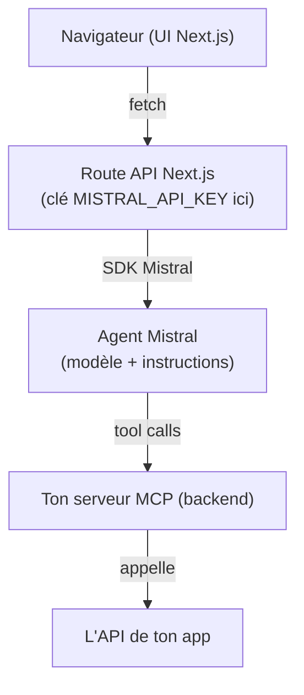

# Créer un agent avec instructions personnalisées dans une app Next.js, branché sur ton API via MCP

## Vue d'ensemble

Trois briques :

1. **Les instructions** : ton system prompt personnalisé (comportement, ton, règles).
2. **L'agent** : le modèle + sa boucle d'outils, appelé depuis une route API Next.js.
3. **Le MCP** : un serveur MCP dans ton backend qui expose l'API de ton app comme outils que l'agent peut appeler.



## Étape 1 : Choisir et installer le SDK

Pour une app Next.js, utilise le SDK TypeScript officiel :

```bash
npm i @mistralai/mistralai
```

- Le package est ESM-only en v2. Si tu es en CommonJS, utilise `await import("@mistralai/mistralai")`, ou épingle la v1 avec `npm i @mistralai/mistralai@^1`.
- Il n'y a **pas de SDK Java officiel** : Mistral fournit des SDK officiels en Python et TypeScript uniquement. En Java, il faudrait appeler l'API REST directement. Reste sur TypeScript pour Next.js.
- Crée une clé API sur console.mistral.ai et mets-la dans tes variables d'environnement (`MISTRAL_API_KEY`), jamais dans le code.

## Étape 2 : Créer l'agent avec ses instructions personnalisées

L'**Agents API** gère pour toi l'historique des conversations, les tool calls et même le handoff entre plusieurs agents. Tu crées l'agent une seule fois (ou via Studio), puis tu l'utilises dans des conversations persistantes.

```ts
import { Mistral } from "@mistralai/mistralai";

const mistral = new Mistral({ apiKey: process.env.MISTRAL_API_KEY! });

// À faire une seule fois
const agent = await mistral.beta.agents.create({
  name: "Assistant MonApp",
  description: "Répond aux utilisateurs de MonApp",
  model: "mistral-small-latest",
  instructions: `Tu es l'assistant de MonApp.
- Tu réponds toujours en français, sur un ton amical.
- Pour toute question sur les commandes, le profil ou les données
  de l'utilisateur, utilise les outils disponibles plutôt que d'inventer.
- Si tu ne sais pas, dis-le.`,
});
```

Conserve l'`agent.id` retourné : c'est lui que tu réutiliseras dans ta route API. Les outils se déclarent dans le paramètre `tools` de l'agent ou de la conversation.

## Étape 3 : Créer la route API Next.js

Le client ne parle jamais directement à Mistral : ta clé reste côté serveur.

```ts
// app/api/chat/route.ts
import { Mistral } from "@mistralai/mistralai";
import { NextRequest } from "next/server";

const mistral = new Mistral({ apiKey: process.env.MISTRAL_API_KEY! });

export async function POST(req: NextRequest) {
  const { message, conversationId } = await req.json();

  // Sans agent pré-créé, tu peux démarrer une conversation avec
  // mistral.beta.conversations.start({ inputs: [...] }) et passer
  // le system prompt en entrée.
  // Avec un agent : transmets son agentId dans les paramètres.

  // Exemple avec streaming :
  // const stream = await mistral.beta.conversations.startStream({ ... });
  // return new Response(streamToReadableStream(stream));

  return Response.json({ reply: "..." });
}
```

Points clés :

- `mistral.beta.conversations.start(...)` pour démarrer une conversation, `startStream(...)` pour streamer la réponse token par token vers le front.
- L'API Conversations gère l'historique : stocke le `conversationId` côté serveur, lié à ton utilisateur connecté, et repasse-le à chaque requête pour que l'agent ait le contexte.
- Teste d'abord sans streaming, ajoute-le ensuite.

## Étape 4 : Brancher ton MCP (l'API de ton app)

Les **Connectors** de Mistral sont des serveurs MCP enregistrés que le modèle utilise comme outils dans une conversation ou un agent, depuis n'importe quel SDK, sans que tu gères le transport MCP toi-même.

```ts
// Enregistrer ton serveur MCP une seule fois
const connector = await mistral.beta.connectors.create({
  name: "mon_app_mcp",
  description: "Outils de l'API de MonApp",
  server: "https://ton-app.com/mcp", // l'URL publique de ton serveur MCP
  visibility: "private",
});
```

Puis passe ce connector dans le `tools` de l'agent ou de la conversation.

Deux points à savoir :

- **Ton serveur MCP doit être accessible en HTTPS** depuis l'infrastructure Mistral (URL publique, certificat TLS valide). En production c'est le cas puisque c'est ton backend déployé ; en local, expose-le via un tunnel ou utilise l'alternative ci-dessous.
- **Ta clé API doit avoir le scope "Private and shared connectors"** pour utiliser un connector privé. Le scope par défaut ("Shared connectors only") ne suffit pas : recrée la clé avec le bon scope.

### Alternative sans exposer ton MCP

Tu peux exécuter la boucle agent toi-même avec l'API **Chat Completions + function calling** : ton `instructions` en message system, tes outils déclarés à la main, et un client MCP (`@modelcontextprotocol/sdk`) branché directement dans ta route Next.js. C'est plus de code, mais tout reste dans ton backend et rien n'est exposé publiquement.

```ts
// Schéma de la boucle (Chat Completions)
const response = await mistral.chat.complete({
  model: "mistral-small-latest",
  messages: [
    { role: "system", content: INSTRUCTIONS },
    ...historique,
  ],
  tools: [{ type: "function", function: { /* ton outil */ } }],
});

// Si le modèle demande un tool : exécute-le, ajoute le résultat
// aux messages, rappelle l'API, recommence jusqu'à la réponse finale.
```

## Étape 5 : Sécurité

- Jamais de `MISTRAL_API_KEY` côté client : tout passe par une route API server-side.
- Ajoute de l'auth (clé ou token) sur ton serveur MCP, sinon n'importe qui peut appeler l'API de ton app via lui.
- Lie les `conversationId` à tes utilisateurs connectés, côté serveur.
- Vérifie dans Studio les traces des appels d'outils pour auditer ce que l'agent fait.

## Ordre de mise en œuvre recommandé

1. Installe le SDK et crée l'agent avec tes instructions.
2. Fais fonctionner une conversation simple dans une route Next.js (sans MCP).
3. Construis ton serveur MCP qui expose l'API de ton app (commence par 1 ou 2 outils).
4. Enregistre-le en Connector et ajoute-le aux tools de l'agent.
5. Ajoute le streaming, puis l'auth et les contrôles de sécurité.

## Ressources

- Docs SDK : docs.mistral.ai/resources/sdks
- SDK TypeScript : github.com/mistralai/client-ts
- Agents & Conversations : docs.mistral.ai (section Agents & Conversations API)
- Connectors (MCP) : docs.mistral.ai (section Connectors)
- API Agents (référence) : docs.mistral.ai/api/endpoint/beta/agents