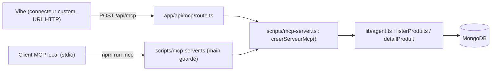

# Serveur MCP de la cafet, exposé en HTTP (mémo)

Objectif : exposer les outils `lister_produits` / `detail_produit` en HTTP pour pouvoir brancher un connecteur personnalisé dans Vibe ("Add custom connector" demande une URL). Le serveur stdio existant (`npm run mcp`) reste dispo pour les clients locaux.

## Architecture



Un seul fichier serveur : `creerServeurMcp()` est exportée et le lancement stdio est guardé (ne tourne que si le fichier est exécuté directement, pas importé par Next). Chaque transport ne fait que connecter la factory. Ne jamais appeler `connect()` au niveau module hors du guard.

## Fichiers

### 1. `frontend/scripts/mcp-server.ts` (modifié : factory exportée + lanceur stdio)

```ts
// Serveur MCP : expose les produits de la cafet à un client MCP.
// - lancé tel quel (npm run mcp) : transport stdio
// - importé par app/api/mcp/route.ts : transport HTTP (le main() ne tourne pas)
import { config } from "dotenv";
config({ path: ".env.local" }); // inoffensif côté Next (ne remplace pas les vars existantes)

import { McpServer } from "@modelcontextprotocol/sdk/server/mcp.js";
import { StdioServerTransport } from "@modelcontextprotocol/sdk/server/stdio.js";
import { z } from "zod";
import { listerProduits, detailProduit } from "../lib/agent";

export function creerServeurMcp() {
  const server = new McpServer({ name: "cafet-produits", version: "1.0.0" });
  const reponse = (data: unknown) => ({
    content: [{ type: "text" as const, text: JSON.stringify(data, null, 2) }],
  });

  server.tool(
    "lister_produits",
    "Liste les produits actifs de la cafet avec id, nom, prix, stock et catégorie. Un stock de 0 veut dire rupture ; les menus n'ont pas de stock.",
    { categorie: z.string().optional().describe("Filtre optionnel : Banh Bao, Nems, Samoussa, Mochis, Desserts, Menus.") },
    async ({ categorie }) => reponse(await listerProduits({ categorie }))
  );

  server.tool(
    "detail_produit",
    "Détail d'un produit par son id : prix, stock, description, composition et options disponibles si menu.",
    { produitId: z.string().describe("L'id du produit.") },
    async ({ produitId }) => reponse(await detailProduit({ produitId }))
  );

  return server;
}

// Lance le transport stdio uniquement si exécuté directement (tsx scripts/mcp-server.ts),
// pas quand Next importe ce fichier pour la route HTTP.
if (process.argv[1]?.endsWith("mcp-server.ts")) {
  creerServeurMcp().connect(new StdioServerTransport());
}
```

### 2. `frontend/app/api/mcp/route.ts` (nouveau : exposition HTTP pour Vibe, protégée par token)

```ts
import { timingSafeEqual } from "node:crypto";
import { WebStandardStreamableHTTPServerTransport } from "@modelcontextprotocol/sdk/server/webStandardStreamableHttp.js";
import { creerServeurMcp } from "@/scripts/mcp-server";

// Auth par token partagé (MCP_API_TOKEN dans .env.local, connu de toi seul).
// Fail closed : si la variable n'est pas définie, on refuse tout.
function autorise(req: Request): boolean {
  const attendu = process.env.MCP_API_TOKEN;
  if (!attendu) return false;
  const recu = req.headers.get("authorization")?.replace(/^Bearer /i, "") ?? "";
  const a = Buffer.from(recu);
  const b = Buffer.from(attendu);
  return a.length === b.length && timingSafeEqual(a, b);
}

// Mode stateless : chaque requête HTTP est indépendante, pas de session à gérer.
export async function POST(req: Request) {
  if (!autorise(req)) {
    return new Response(JSON.stringify({ error: "Unauthorized" }), {
      status: 401,
      headers: { "Content-Type": "application/json" },
    });
  }
  const server = creerServeurMcp();
  const transport = new WebStandardStreamableHTTPServerTransport({ sessionIdGenerator: undefined });
  await server.connect(transport);
  const res = await transport.handleRequest(req);
  // Ne pas fermer tout de suite : la réponse est un flux SSE encore en cours d'écriture.
  // Le serveur est fermé quand le flux est terminé (flush), sinon le client reçoit un body vide.
  const body = res.body;
  if (!body) {
    await server.close();
    return res;
  }
  const stream = body.pipeThrough(
    new TransformStream({ flush: async () => { await server.close(); } })
  );
  return new Response(stream, res);
}
```

Générer le token et le mettre dans `frontend/.env.local` (jamais dans le code) :

```bash
openssl rand -hex 32 >> frontend/.env.local   # sous la forme MCP_API_TOKEN=...
```

SDK requis : `@modelcontextprotocol/sdk` >= 1.18 (installe : 1.32.2, OK). Le transport web standard (`webStandardStreamableHttp.js`) prend un `Request`/`Response` standard, donc compatible route Next.js App Router sans adapteur.

## Brancher Vibe (dialog "Add custom connector")

| Champ | Valeur |
|---|---|
| Connector name | `cafet-produits` |
| Server | `http://localhost:3000/api/mcp` (dev server actif via `./start.sh`) |
| Description | optionnel, ex. "Catalogue, stocks et commandes de la cafet CESI" |
| Authentication | `Bearer token`, puis colle la valeur de `MCP_API_TOKEN` (ou référence la var d'env si le dialog le propose). Ne laisse pas `Auto-detect` : sans auth, n'importe qui peut appeler l'endpoint |

Le dialog ne accepte que des URL HTTP(S) : pour un serveur local en stdio, utiliser à la place `~/.vibe/config.toml` (ou `.vibe/config.toml` au niveau projet) :

```toml
[[mcp_servers]]
name = "cafet-produits"
transport = "stdio"
command = "npm"
args = ["--prefix", "/Users/enzofraioli/Documents/Perso/Projets Perso/Programmation/hackathon/frontend", "run", "mcp"]

# Variante HTTP avec token (pour un client qui ne gere que les URL) :
[[mcp_servers]]
name = "cafet-produits-http"
transport = "streamable-http"
url = "http://localhost:3000/api/mcp"
[mcp_servers.auth]
type = "static"
api_key_env = "MCP_API_TOKEN"
api_key_header = "Authorization"
api_key_format = "Bearer {token}"
```

Le `--prefix .../frontend` force le cwd = frontend, indispensable car le script stdio charge `.env.local` (MONGODB_URI) en chemin relatif.

## Pièges et règles

- **stdout = canal du protocole en stdio** : jamais de `console.log` sur stdout côté serveur, logs sur stderr uniquement.
- **Connexion longue durée côté client** : un seul `Client` réutilisé (singleton), `client.close()` à l'arrêt, reconnect si `onclose` (crash du process). Ne pas spawn un process par requête.
- **Jamais de secret dans le code** : `.env.local` (MONGODB_URI, MISTRAL_API_KEY, MCP_API_TOKEN), chargé par Next automatiquement pour la route HTTP, par dotenv pour le script stdio. Si le token fuite (repo public, capture d'écran), le révoquer = changer la valeur dans `.env.local` et redémarrer.
- **Token obligatoire sur `/api/mcp`** : la route renvoie 401 sans `Authorization: Bearer <MCP_API_TOKEN>`, et aussi si la variable n'est pas définie (fail closed). Le token ne sort jamais du `.env.local` et du client Vibe.
- Un seul serveur dev à la fois (règle AGENTS.md) : la route `/api/mcp` vit dans le même `next dev` que l'app, pas de deuxième serveur.
- En HTTP stateless, seul `POST` est utile ; pas besoin de GET/SSE.

## Bonnes pratiques MCP (résumé, sources Anthropic + spec MCP)

- Tools = contrat avec un agent non déterministe : peu d'outils, chacun un but clair, descriptions comme pour un nouveau (contexte implicite rendu explicite), noms de params sans ambiguïté.
- Namespacing par préfixe service (`cafet_lister_produits`) si plusieurs serveurs chez le même client.
- Annotations sur chaque tool : `readOnlyHint: true` pour les deux tools lecture actuels.
- Erreurs dans le result (`isError: true`) avec message actionnable, jamais de stack trace ; validation stricte des entrées (zod).
- Efficacité token : `limit` + pagination (`has_more`, `next_offset`) sur les listes, troncature ~25 000 caractères avec message qui guide le filtre.
- Évaluer avant d'ajouter des outils : tâches réalistes, boucle agent, mesurer accuracy + nb d'appels + erreurs.

Sources : anthropic.com/research/writing-tools-for-agents, anthropic.com/research/code-execution-with-mcp, modelcontextprotocol.io/specification (server/tools), modelcontextprotocol.io/docs/develop/build-server.
